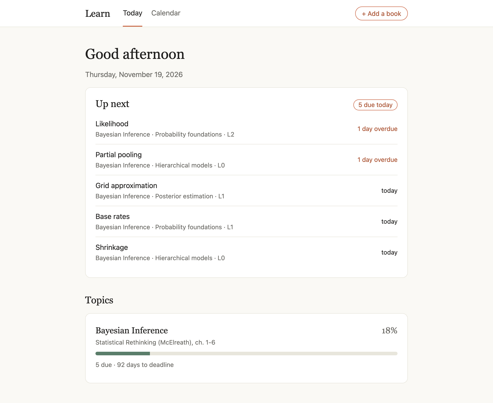

# learn

A plain-text spaced-learning folder for working through books and topics: every concept, level and review date is stored in a `.txt` file you can read and edit yourself. Claude (or Codex) acts as a Socratic tutor through a tiny local MCP server, and a small local web page shows your progress and review calendar.



## Quick start

```bash
git clone <repo> learn && cd learn
python -m venv .venv && source .venv/bin/activate   # Windows: .venv\Scripts\activate
pip install -r requirements.txt
python view.py        # open http://127.0.0.1:8765
```

## Connect an AI client (no API key)

- **Claude Code:** run `claude` inside the folder. It picks up `.mcp.json` automatically; approve the `learn` server when prompted.

  ```json
  { "mcpServers": { "learn": { "command": "python", "args": ["mcp_server.py"] } } }
  ```

  If `python` doesn't resolve to the venv's Python (`claude mcp list` shows `learn … Failed to connect`), register it for just your machine with the venv's absolute path. This overrides `.mcp.json` without changing it:

  ```bash
  claude mcp add learn --scope local -- "$PWD/.venv/bin/python" "$PWD/mcp_server.py"
  ```

- **Claude Desktop:** add the same `learn` entry to `claude_desktop_config.json`, using the absolute path to the venv's Python as `command` and the absolute path to `mcp_server.py` in `args`. Then restart Claude Desktop.

- **Codex:** `codex mcp add learn -- /abs/path/.venv/bin/python /abs/path/mcp_server.py`, or add this to `~/.codex/config.toml`:

  ```toml
  [mcp_servers.learn]
  command = "/abs/path/.venv/bin/python"
  args = ["/abs/path/mcp_server.py"]
  ```

## Daily workflow

Ask "what's due?" → do a tutor session → levels update as you go → refresh the web page to see them.

## Adding a book

Say something like: "Add *Statistical Rethinking* ch. 1–6 as a topic." The tutor proposes an outline of general concepts, confirms it with you, and then creates the topic file. The **+ Add a book** button on the web page shows these steps, plus how to write the file by hand.

## File format

`topics/<slug>.txt`:

```
topic: Bayesian Inference
source: Statistical Rethinking (McElreath), ch. 1-6
deadline: 2027-02-19

[Probability foundations]
Bayes' rule             | 2 | 2026-11-21
Conditional probability | 3 | 2026-11-25
```

- `topic:` is required. `source:` and `deadline:` (YYYY-MM-DD) are optional.
- `[General concept]` starts a group. Concept lines are `name | level (0-5) | next review date`.
- Blank lines and lines starting with `#` are ignored.

Hand edits are fine. Malformed lines are reported (in tool output and on the web page) and kept as they are. `calendar.txt` is generated; don't edit it. `log.txt` is an append-only session log.

## How scheduling and mixing work

After a review, the next review date is today plus:

| level | 0 | 1 | 2 | 3 | 4 | 5 |
|---|---|---|---|---|---|---|
| days | 1 | 2 | 4 | 7 | 14 | 30 |

New concepts start at level 0, due today. Today's queue interleaves due concepts round-robin across general concepts (most overdue first), so you don't review the same group twice in a row.

## Credits

Socratic Tutor skill adapted from Jane Street's skill ([janestreet/agent_skills](https://github.com/janestreet/agent_skills)); see `skills/socratic-tutor/SKILL.md`.
The learning principles draw on *Make It Stick*, *Ultralearning* and *A Mind for Numbers*.

## License

MIT
